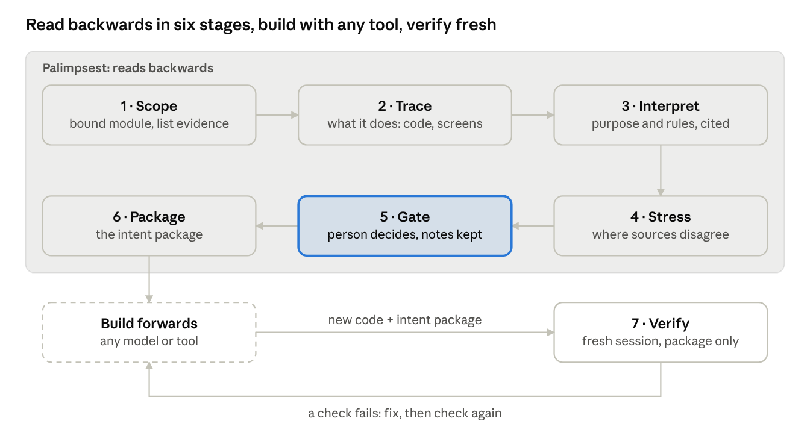

# Palimpsest

*Working name.* Read an existing module backwards — code, screens, data — into an **intent package** that any model or tool can build forwards from.

A palimpsest is a manuscript page scraped and written over, where the earlier text can still be read beneath the new one. A legacy module is the same.

## Status

Concept, draft 1 (2026-11-07). Nothing built yet.

- Concept document: [`concept/palimpsest-concept.md`](concept/palimpsest-concept.md) (exported from the editable [Claude Docs version](https://claude.ai/artifact/NYN7GqnXQWk6HBfB1Fa5eL), which stays the working copy)
- Where to pick up: [`NEXT.md`](NEXT.md)

## Lineage

Draws on Phoenix (extraction stages), Governance-Driven Design (rule statuses, residue with an owner), Strata (transform / preserve / retire), ABSORB (autonomy set by evidence) and the lessons of case PX-001. Examples come from personal projects only.
