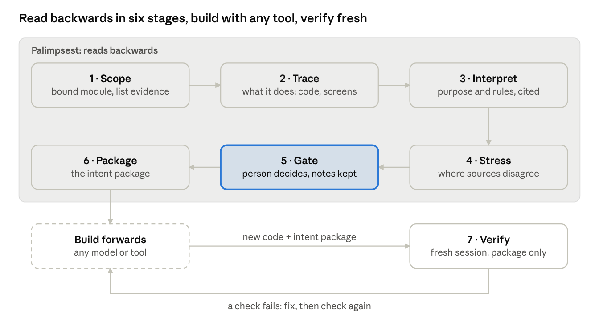

# Palimpsest — reading intent backwards

Nov 7, 2026 · Michael · Concept, draft 1 · exported from the [concept doc](https://claude.ai/artifact/NYN7GqnXQWk6HBfB1Fa5eL)

## The name and the idea

Palimpsest reads an existing module backwards, from its code, screens and data, into an intent package that any model or tool can build forwards from. It does one job: recover what the module is for and which rules it must keep, with evidence for each, before anything is rebuilt, ported or changed.

A palimpsest is a manuscript page scraped and written over, where the earlier text can still be read beneath the new one. A legacy module is the same: years of changes written over an original intent that is still there to be read. The name also pairs with Phoenix, which rebuilds from what was there.

Working name. Alternatives considered: *Intent Extraction* (plain, but unsearchable) and *Read Backwards* (describes the move, not the thing). A name check is still to do.

## Why read backwards

Every transformation passes through intent, and AI has made the forward half cheap, so the backward half is now where the leverage is.

- **Intent belongs to neither technology.** Code is tied to its language, screens to their framework, data to its schema. What a module is for, and the rules it must keep, carries over to any target.
- **Building forwards is now cheap.** In PX-001 the whole rebuild, five build passes and 51 tests, ran in one afternoon session once the target was clear.
- **A straight port keeps the bugs.** It preserves behaviour, wrong behaviour included. Reading for intent is what found PX-001's cascade-delete bug and the unguarded loan-to-value division.
- **The module is the natural unit.** Legacy work happens one tangled module at a time while the system keeps running. Reading backwards is a move one person can make in an afternoon, not a programme.

The idea is not new: business rule extraction is decades old in mainframe work, and spec-driven development is the current trend. What is new is the cost. Reading backwards used to be a specialist project; with AI it is a routine first step before any change.

## What it draws from

Palimpsest is mostly a reassembly: each existing framework supplies one piece.

| Source | What Palimpsest takes from it |
| --- | --- |
| Phoenix | The extraction stages (signals, workflow traces, screens, intent specs), episodes for a change of direction, and certification by a separate agent |
| Governance-Driven Design | A status on every rule (RESOLVED, ASSUMED, UNKNOWN, CONFLICT) and the rule that unresolved residue gets a named owner before building starts |
| Strata | A disposition for every part: transform, preserve or retire |
| ABSORB | Autonomy set by evidence: how much a forward build may do without review depends on how well each workflow's rules are established |
| Claims ledger | Every rule cites where it came from, and nothing is stated more strongly than its evidence |
| PX-001 lessons | Gate decisions written down with notes, skipped steps recorded as skipped, verification in a fresh session that never saw the build |

What it drops from Phoenix: the architecture and build stages. Building forwards is left to whatever model or tool the team already uses.

## The pipeline

Six stages read the module backwards and stop at one human gate; the build is left to any tool, and a fresh session checks the result.



Only the gate needs a person to decide; every other stage produces files a person can read and correct.

| Stage | Reads | Writes | The person |
| --- | --- | --- | --- |
| 1 Scope | The module, its repo, any docs | Scope and source list in `README.md` | Confirms the boundary and who to ask |
| 2 Trace | Code paths, screen paths, data samples, logs | Observed steps per workflow | Says whether a path is still used |
| 3 Interpret | The traces | Rules with evidence, status and confidence | Nothing yet; unsettled rules stay ASSUMED or UNKNOWN |
| 4 Stress | Rules against code, screens, data and docs | `conflicts.md`, `boundaries.md` | Nothing yet |
| 5 Gate | Conflicts and UNKNOWN rules | `decisions.md`, a note per decision | Decides each conflict or names its owner |
| 6 Package | Everything above | `disposition.md`, `forward.md`, `verify.md`, `intent.yaml` | Approves the package for building |
| 7 Verify | `intent/` and the new code only | Pass, fail or not testable, per check | Reads the failures |

## The intent package

The output is a folder of plain Markdown that any tool can read, plus one small index file that tools can check coverage against.

| File | What it holds |
| --- | --- |
| `README.md` | What the module is for, who uses it, the scope, the sources read, overall confidence |
| `workflows/<name>.md` | One per workflow: purpose, trigger, steps as observed, rules, edge cases, screen notes, acceptance checks |
| `data.md` | What the entities mean (not the schema) and what must always hold true |
| `boundaries.md` | Integrations, side effects, timing and external calls: the behaviour code reading misses |
| `conflicts.md` | Where code, screens, data and docs disagree, each with an owner and a decision |
| `disposition.md` | Transform, preserve or retire for each part |
| `forward.md` | Rules that must not change, areas free to redesign, autonomy level per workflow, suggested order of slices |
| `verify.md` | How a fresh session checks the new build, and which tests to capture from the old system first |
| `decisions.md` | Every gate decision with its note, and any change of direction |
| `intent.yaml` | Index of rule IDs, statuses and checks |
| `AGENTS.md` snippet | One paragraph for the repo: read the workflow file before changing it, keep its rules, raise a conflict instead of guessing |

### The rule format

Every rule carries the same seven fields, so a builder can act on it and a checker can test it:

1. **ID and statement.** One sentence of what must hold.
2. **Evidence.** Where it was read: file and function, screen, data sample, document or person.
3. **Status.** RESOLVED, ASSUMED, UNKNOWN or CONFLICT.
4. **Confidence.** High, medium or low, with a reason when not high.
5. **Edge cases.** What happens at the limits, including what the old system did wrong.
6. **Acceptance check.** Given, when, then: written so it can become a test.
7. **Disposition.** Transform, preserve or retire.

The package says what must stay true and leaves how to the builder. That separation is what lets a forward build improve the module rather than copy it.

## Worked example: PX-001

PX-001 rebuilt wealth2track, a paused Flutter and Firebase app, in one session on 3 April 2026. Its extraction already found the right things; what it lacked was the package around them. Three rules as Palimpsest would have written them:

```
R-PORT-03  Loan-to-value is total borrowings ÷ market value, per property
  evidence:    original market-value model; "Market values" screen
  status:      RESOLVED · confidence: high
  edge case:   market value 0 → original shows NaN or Infinity → conflict C-02
  check:       Given a property with market value 0, when its LTV is shown,
               then it reads "—"
  disposition: transform

R-PROP-07  Deleting a property deletes its additional expenses
  evidence:    original cascade delete targets 'additionalProperties'
  status:      CONFLICT (C-01): the code deletes from the wrong collection
  check:       Given a property with two additional expenses, when it is deleted,
               then no additional expense remains for it
  disposition: transform

R-SET-02   Amounts convert between CAD and USD at the user's exchange rate
  evidence:    settings screen; spec default 1.42, label "USD/CAD"
  status:      CONFLICT (C-03): rate direction unclear
  decision:    owner, 3 Apr 2026: 0.72, read as 1 CAD = 0.72 USD
  disposition: transform
```

What the package would have changed in PX-001:

- **The exchange-rate condition** would have been settled at the gate, with a written note, before building, not after certification.
- **A cash-flow check** in `verify.md` would have caught the one-time expense that the rebuild counts in full every month.
- **The offline claim** would have sat in `boundaries.md` as an open item, not on the case page as a result.
- **Certification** would have run in a fresh session given only the package and the new code.

## Worked example: the StratIQX report pipeline

Two refactors carried a bug forward; writing down what each document was for fixed it in under 30 minutes. That fix is where Semantic Intent as a single source of truth began.

**The module.** The worker behind the StratIQX strategic consulting platform: one large file that produced reports in three types, brief, basic and comprehensive. A brief is a companion to a basic or comprehensive report, not a depth setting of its own.

**The bug.** The output pipeline did not tell the types apart. As the SSOT paper reports, different requests came out as identical 486,337-byte PDFs, because a technical flag (`isExecutive = analysisDepth === 'quick'`) decided the document type instead of what had been asked for.

| Attempt | What changed | Result |
| --- | --- | --- |
| 1. Abstract service pattern | The file was split into services | The bug moved with the code |
| 2. Document chaining pattern | Rebuilt as chained documents | The bug moved again |
| 3. Semantic anchoring, intent mapping, immutability | The monolith kept; each type tied to what it is for, and that mapping frozen | Fixed in under 30 minutes |

**What it shows for Palimpsest.** A refactor rearranges implementation, so a bug that lives in the implementation survives any rearrangement. The fix came from reading backwards: stating what each document type is for, then holding the code to that statement. As a Palimpsest rule:

```
R-DOC-01   A report's type is set by what was requested, never by a technical flag
  evidence:    isExecutive derived from analysisDepth === 'quick'
  status:      CONFLICT (C-01): the code ties type to analysis depth
  decision:    type comes from the request; the brief is a companion to its parent report
  check:       Given requests for a brief and a comprehensive report on the same case,
               then two different documents are produced
  disposition: transform
```

## How it runs on any model

Palimpsest is a set of plain instructions and file formats, not a runtime, so any capable model in any coding tool can run it.

- **Each stage is one short instruction file.** It says what to read, what to write and when to stop for a person. No stage depends on a particular model or vendor.
- **Everything passes through files in the repo.** Each stage reads the previous stage's files and writes its own, so a run can pause, change hands or switch tools between stages.
- **It runs where the work already is.** The first form would be a Claude Code skill ("read this module backwards"), because a tool people have to remember to run goes unused. The same instruction files work in Cursor, Copilot or a plain chat with the files attached.
- **The forward build is not part of it.** Any agent, any harness. The package's `AGENTS.md` snippet points that agent at the workflow files before it changes anything.
- **Verification is a separate run.** A fresh session gets `intent/` and the new code, never the build conversation, and reports each acceptance check as passed, failed or not testable.

## Risks and next steps

The main risk is intent that reads well and is wrong; the next step is testing Palimpsest against a straight port.

**Risks**

- **Plausible but wrong intent.** A model can write a confident purpose for code it misread. Evidence on every rule and a CONFLICT status are the defence; the fresh-session check is the backstop.
- **Behaviour outside the code.** Timing, side effects and data the code quietly relies on do not show in a reading. `boundaries.md` makes the gap visible; filling it needs logs, data samples or a person.
- **Intent nobody knows.** Some rules have no recoverable reason. The honest output is UNKNOWN with an owner, not a guess.
- **Ceremony creep.** Phoenix's build stages became more process than the job needed. Palimpsest should stay small enough to run on one module in one sitting.

**Next steps**

1. Write the stage instructions, one short file per stage.
2. Re-run the extraction on wealth2track and compare it with Phoenix's A-00 to A-03 output: same rules found, same bugs?
3. Write the StratIQX case up as a full intent package, as a second reference beside PX-001.
4. PX-002 as a two-way test on a module neither run has seen: a straight port from a minimal spec against Palimpsest then build, comparing defects carried over, findings, time and the record each leaves.
5. The essay for semanticintent.dev, *Read backwards, build forwards*, from the PX-002 result.
